# Домашнее задание к занятию «Сетевое взаимодействие в Kubernetes» -Kadancev Vladimir

### Примерное время выполнения задания

120 минут

### Цель задания

Научиться настраивать доступ к приложениям в Kubernetes:
- Внутри кластера через **Service** (ClusterIP, NodePort).
- Снаружи кластера через **Ingress**.

Это задание поможет вам освоить базовые принципы сетевого взаимодействия в Kubernetes — ключевого навыка для работы с кластерами.
На практике Service и Ingress используются для доступа к приложениям, балансировки нагрузки и маршрутизации трафика. Понимание этих механизмов поможет вам упростить управление сервисами в рабочих окружениях и снизит риски ошибок при развёртывании.

------

## **Подготовка**
### **Чеклист готовности**
- Установлен Kubernetes (MicroK8S, Minikube или другой).
- Установлен `kubectl`.
- Редактор для YAML-файлов (VS Code, Vim и др.).

------

### Инструменты, которые пригодятся для выполнения задания

1. [Инструкция](https://microk8s.io/docs/getting-started) по установке MicroK8S.
2. [Инструкция](https://minikube.sigs.k8s.io/docs/start/?arch=%2Fwindows%2Fx86-64%2Fstable%2F.exe+download) по установке Minikube. 
3. [Инструкция](https://kubernetes.io/docs/tasks/tools/install-kubectl-windows/)по установке kubectl.
4. [Инструкция](https://marketplace.visualstudio.com/items?itemName=ms-kubernetes-tools.vscode-kubernetes-tools) по установке VS Code

### Дополнительные материалы, которые пригодятся для выполнения задания

1. [Описание](https://kubernetes.io/docs/concepts/workloads/controllers/deployment/) Deployment и примеры манифестов.
2. [Описание](https://kubernetes.io/docs/concepts/services-networking/service/) Описание Service.
3. [Описание](https://kubernetes.io/docs/concepts/services-networking/ingress/) Ingress.
4. [Описание](https://github.com/wbitt/Network-MultiTool) Multitool.

------

## **Задание 1: Настройка Service (ClusterIP и NodePort)**
### **Задача**
Развернуть приложение из двух контейнеров (`nginx` и `multitool`) и обеспечить доступ к ним:
- Внутри кластера через **ClusterIP**.
- Снаружи через **NodePort**.

### **Шаги выполнения**
1. **Создать Deployment** с двумя контейнерами:
   - `nginx` (порт `80`).
   - `multitool` (порт `8080`).
   - Количество реплик: `3`.
2. **Создать Service типа ClusterIP**, который:
   - Открывает `nginx` на порту `9001`.
   - Открывает `multitool` на порту `9002`.
3. **Проверить доступность** изнутри кластера:
```bash
 kubectl run test-pod --image=wbitt/network-multitool --rm -it -- sh
 curl <service-name>:9001 # Проверить nginx
 curl <service-name>:9002 # Проверить multitool
```
4. **Создать Service типа NodePort** для доступа к `nginx` снаружи.
5. **Проверить доступ** с локального компьютера:
```bash
 curl <node-ip>:<node-port>
   ```
 или через браузер.

### **Что сдать на проверку**
- Манифесты:
  - `deployment-multi-container.yaml`
  - `service-clusterip.yaml`
  - `service-nodeport.yaml`
- Скриншоты проверки доступа (`curl` или браузер).

## Решение:
### Deployment из двух контейнеров (3 реплики)

Манифест: [deployment-multi-container.yaml](https://github.com/valdemar-2502/Networking-in-Kubernetes-Homeworks/blob/main/deployment-multi-container.yaml)

- `nginx` слушает порт 80;
- `multitool` слушает порт 8080 (переменная `HTTP_PORT=8080`, иначе он конфликтовал бы с nginx за порт 80 в общем сетевом пространстве пода).

```
kubectl apply -f deployment-multi-container.yaml
kubectl get pods -l app=multi-container-app
```

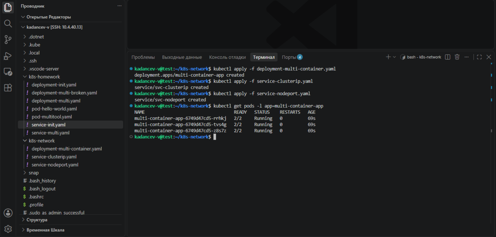

### Service типа ClusterIP

Манифест: [service-clusterip.yaml](https://github.com/valdemar-2502/Networking-in-Kubernetes-Homeworks/blob/main/service-clusterip.yaml)

Порт 9001 ведёт на nginx (80), порт 9002 ведёт на multitool (8080).

```
kubectl apply -f service-clusterip.yaml
kubectl get svc
```
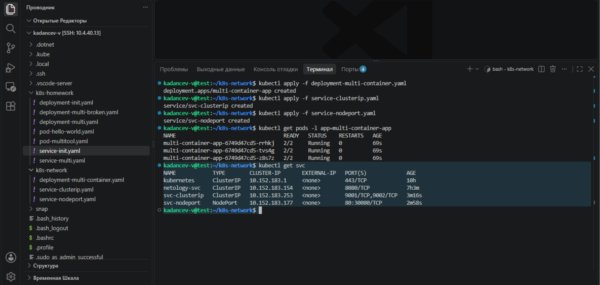

### Проверка доступа изнутри кластера

```
kubectl run test-pod --image=wbitt/network-multitool:minimal --image-pull-policy=IfNotPresent --rm -it -- sh
curl svc-clusterip:9001
curl svc-clusterip:9002
```

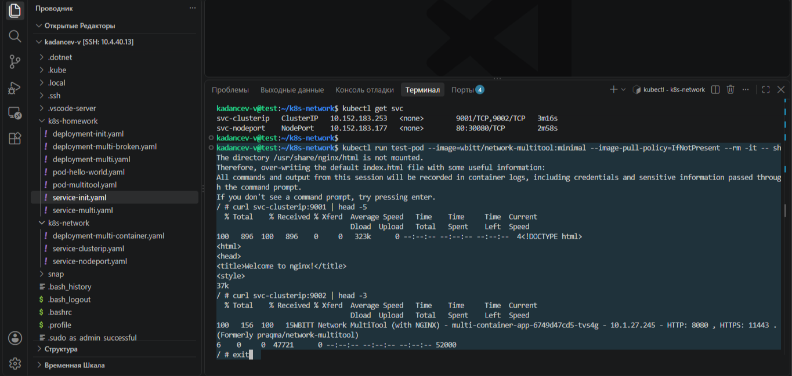

### Service типа NodePort

Манифест: [service-nodeport.yaml](https://github.com/valdemar-2502/Networking-in-Kubernetes-Homeworks/blob/main/service-nodeport.yaml)

Nginx доступен снаружи кластера на порту узла `30080`.

```
kubectl apply -f service-nodeport.yaml
curl <node-ip>:30080
```

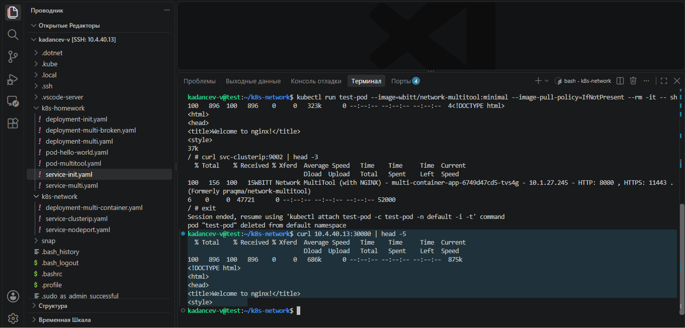
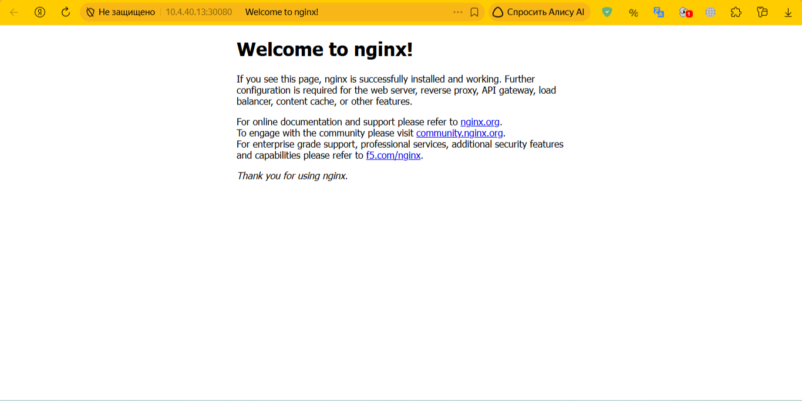

---

---
## **Задание 2: Настройка Ingress**
### **Задача**
Развернуть два приложения (`frontend` и `backend`) и обеспечить доступ к ним через **Ingress** по разным путям.

### **Шаги выполнения**
1. **Развернуть два Deployment**:
   - `frontend` (образ `nginx`).
   - `backend` (образ `wbitt/network-multitool`).
2. **Создать Service** для каждого приложения.
3. **Включить Ingress-контроллер**:
```bash
 microk8s enable ingress
   ```
4. **Создать Ingress**, который:
   - Открывает `frontend` по пути `/`.
   - Открывает `backend` по пути `/api`.
5. **Проверить доступность**:
```bash
 curl <host>/
 curl <host>/api
   ```
 или через браузер.

### **Что сдать на проверку**
- Манифесты:
  - `deployment-frontend.yaml`
  - `deployment-backend.yaml`
  - `service-frontend.yaml`
  - `service-backend.yaml`
  - `ingress.yaml`
- Скриншоты проверки доступа (`curl` или браузер).

---
## Шаблоны манифестов с учебными комментариями
### **1. Deployment (nginx + multitool)**
```yaml
apiVersion: apps/v1
kind: Deployment
metadata:
  name: # ПРИМЕР: "multi-container-app"
spec:
  replicas: # ЗАДАНИЕ: Укажите количество реплик
  selector:
    matchLabels:
      app: # ДОПОЛНИТЕ: Метка для селектора
  template:
    metadata:
      labels:
        app: # ПОВТОРИТЕ метку из selector.matchLabels
    spec:
      containers:
 - name: # ЗАДАНИЕ: Название первого контейнера
        image: nginx
        ports:
 - containerPort: 80
 - name: multitool
        image: wbitt/network-multitool
        ports:
 - containerPort: 8080
        env:
 - name: HTTP_PORT
          value: "8080" # КЛЮЧЕВОЙ МОМЕНТ: Порт должен совпадать с containerPort
```
### **2. Ingress (для frontend и backend)**
```yaml
apiVersion: networking.k8s.io/v1
kind: Ingress
metadata:
  name: # ЗАДАНИЕ: Придумайте имя, допустим example-ingress
  annotations:  # ВАЖНО: Эта аннотация нужна для rewrite правил
    nginx.ingress.kubernetes.io/rewrite-target: /
spec:
  rules:
 - http:
      paths:
 - path: /
        pathType: Prefix
        backend:
          service:
            name: # УКАЖИТЕ: Имя frontend Service
            port:
              number: 80
 - path: /api # КЛЮЧЕВОЙ ПУТЬ: API endpoint
        pathType: Prefix
        backend:
          service:
            name: # УКАЖИТЕ: Имя backend Service
            port:
              number: 80
```
---
## Решение:

## Манифесты:
- [deployment-frontend.yaml](https://github.com/valdemar-2502/Networking-in-Kubernetes-Homeworks/blob/main/deployment-frontend.yaml), [service-frontend.yaml](https://github.com/valdemar-2502/Networking-in-Kubernetes-Homeworks/blob/main/service-frontend.yaml): frontend на `nginx:alpine`;
- [deployment-backend.yaml](https://github.com/valdemar-2502/Networking-in-Kubernetes-Homeworks/blob/main/deployment-backend.yaml), [service-backend.yaml](https://github.com/valdemar-2502/Networking-in-Kubernetes-Homeworks/blob/main/service-backend.yaml): backend на `wbitt/network-multitool:minimal`;
- [ingress.yaml](https://github.com/valdemar-2502/Networking-in-Kubernetes-Homeworks/blob/main/ingress.yaml): маршрутизация `/` на frontend и `/api` на backend;
- [middleware-strip-api.yaml](https://github.com/valdemar-2502/Networking-in-Kubernetes-Homeworks/blob/main/middleware-strip-api.yaml): убирает префикс `/api`.

```
kubectl apply -f deployment-frontend.yaml -f deployment-backend.yaml
kubectl apply -f service-frontend.yaml -f service-backend.yaml
kubectl get pods,svc
```

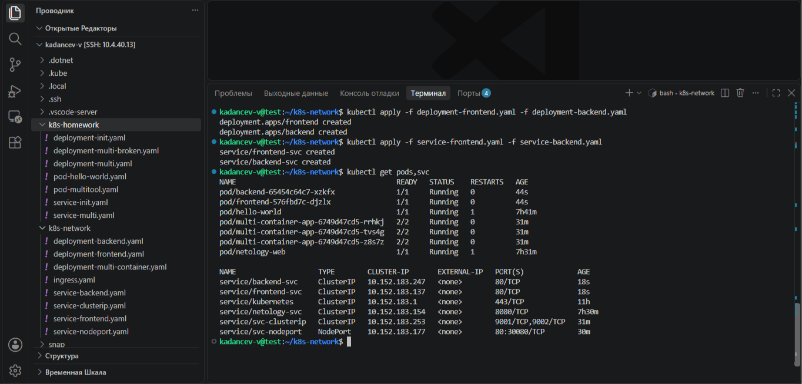

### 2.1. Ingress-контроллер

```bash
microk8s enable ingress
kubectl get pods -n ingress
kubectl get ingressclass
```

В используемой версии MicroK8s аддон `ingress` устанавливает **Traefik**, а не nginx-ingress
(`CONTROLLER: traefik.io/ingress-controller`, классы `public`, `nginx`, `traefik`).

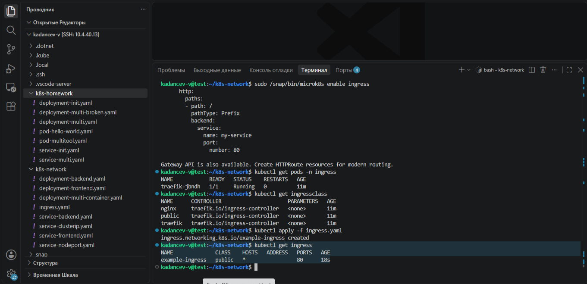

### 2.2. Ingress и особенность Traefik

Аннотация `nginx.ingress.kubernetes.io/rewrite-target: /` из шаблона относится к nginx-ingress, Traefik её игнорирует.
Поэтому после первого применения `/` отвечал nginx (frontend), а `/api` возвращал `404 Not Found`:
запрос уходил в backend с путём `/api`, а такой страницы у multitool нет.

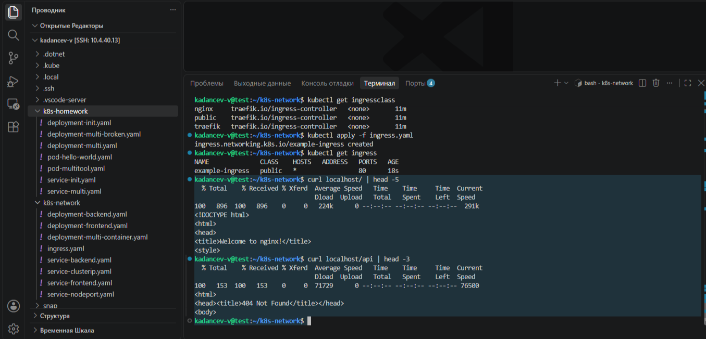

Решение: Middleware Traefik `stripPrefix`, который убирает `/api` перед передачей запроса в backend,
и аннотация `traefik.ingress.kubernetes.io/router.middlewares: default-strip-api@kubernetescrd` в Ingress.

```
kubectl apply -f middleware-strip-api.yaml
kubectl apply -f ingress.yaml
kubectl get ingress
kubectl get middleware
```

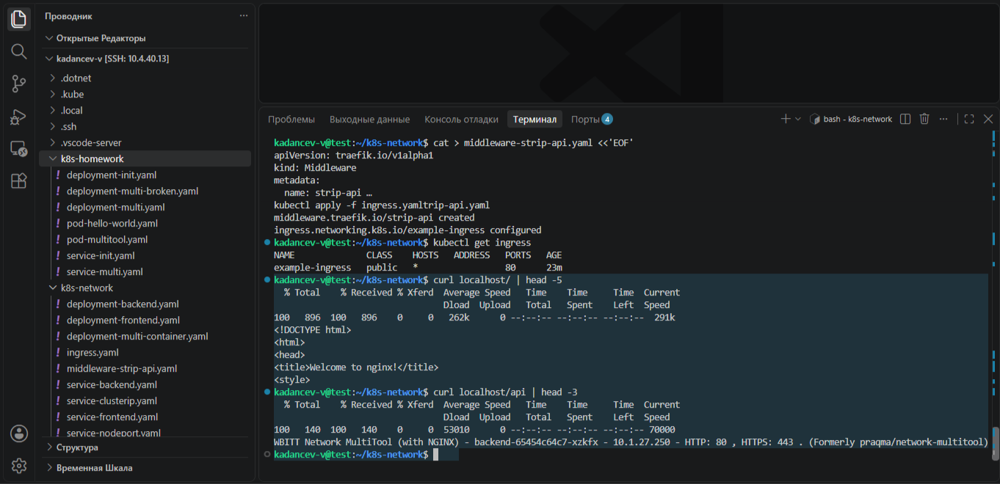

### Проверка доступа

```bash
curl localhost/
curl localhost/api
```

`/` возвращает страницу nginx (frontend), `/api` возвращает ответ multitool (backend).

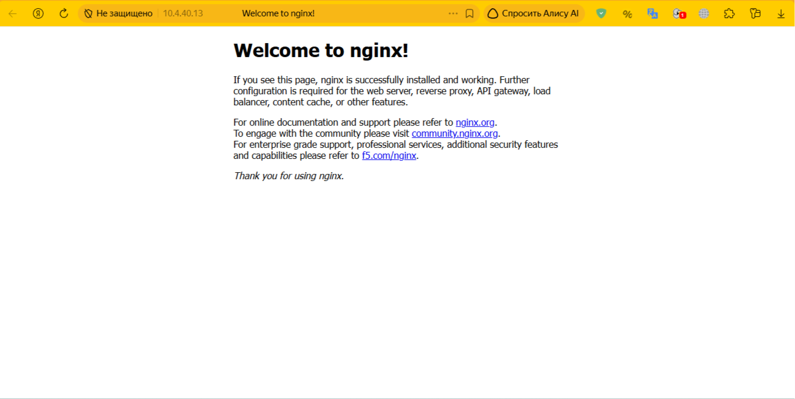
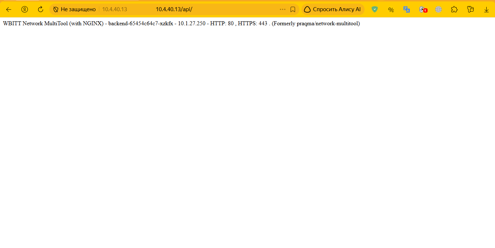

---

## **Правила приёма работы**
1. Домашняя работа оформляется в своём Git-репозитории в файле README.md. Выполненное домашнее задание пришлите ссылкой на .md-файл в вашем репозитории.
2. Файл README.md должен содержать скриншоты вывода необходимых команд `kubectl` и скриншоты результатов.
3. Репозиторий должен содержать тексты манифестов или ссылки на них в файле README.md.

## **Критерии оценивания задания**
1. Зачёт: Все задачи выполнены, манифесты корректны, есть доказательства работы (скриншоты).
2. Доработка (на доработку задание направляется 1 раз): основные задачи выполнены, при этом есть ошибки в манифестах или отсутствуют проверочные скриншоты.
3. Незачёт: работа выполнена не в полном объёме, есть ошибки в манифестах, отсутствуют проверочные скриншоты. Все попытки доработки израсходованы (на доработку работа направляется 1 раз). Этот вид оценки используется крайне редко.

## **Срок выполнения задания**  
1. 5 дней на выполнение задания.
2. 5 дней на доработку задания (в случае направления задания на доработку).
